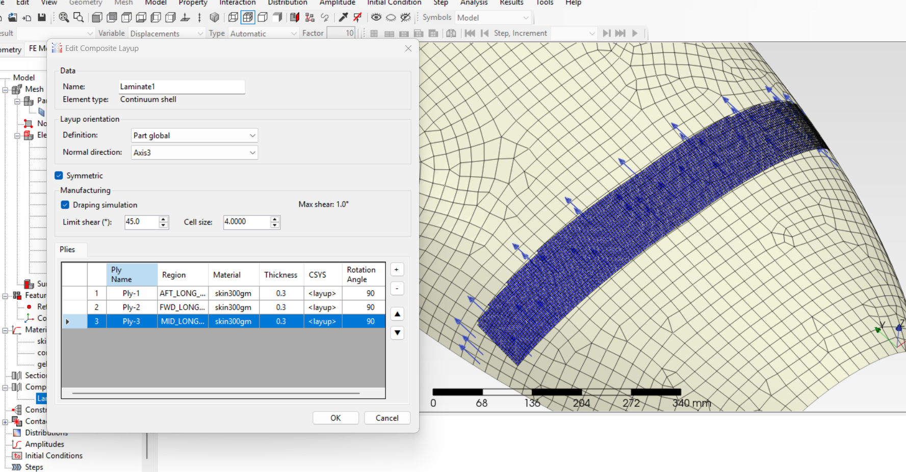

# PrePoMax Composites Fiber Modeler

## Introduction

The PrePoMax Composites Fiber Modeler is an extension to the PrePoMax finite element pre-processor that enables advanced modeling of fiber-reinforced composite materials and laminated structures. This module provides comprehensive tools for defining orthotropic material properties, creating composite layups, and managing fiber orientations for shell-based composite structures in CalculiX finite element analysis.

## Main Functionalities

### Material Definition
- **Engineering Constants**: Define orthotropic materials using engineering constants (E1, E2, E3, Nu12, Nu13, Nu23, G12, G13, G23)
- **Lamina Properties**: Specify lamina-specific material behavior for fiber-reinforced composites
- **Equation Support**: Material properties can be defined as constants or temperature-dependent equations

### Composite Layup Management
- **Layer Stacking**: Define composite layups with multiple plies, each with specific material, thickness, and fiber orientation
- **Fiber Orientation Control**: Specify fiber directions for each ply relative to the element coordinate system
- **CSV Import/Export**: Bulk import/export of composite layup definitions from/to CSV files
- **KinDrape Integration**: Advanced kinematics draping simulation capabilities for mapping 2D fiber patterns onto 3D surfaces

### Analysis Output
- **CalculiX Integration**: Automatic generation of `*ORIENTATION`, `*SHELL SECTION`, and `*SOLID SECTION` keywords for composite structures
- **Material Property Export**: Conversion of engineering constants to CalculiX-compatible `*ELASTIC` definitions with `TYPE=ENGINEERING CONSTANTS`

## Key Source Files

### Model Classes (CaeModel)
- `CaeModel/Materials/EngineeringConstants.cs` - Orthotropic material property definition with temperature dependence
- `CaeModel/Materials/Lamina.cs` - Lamina-specific material properties for composites
- `CaeModel/Materials/Material.cs` - Base material class hierarchy
- `CaeModel/Composite/CompositeLayup.cs` - Composite layup definition and management
- `CaeModel/Composite/KinDrape.cs` - Draping simulation for fiber orientation mapping

### File I/O (CaeModel)
- `CaeModel/FileInOut/Output/Calculix/Keywords/ModelDefinition/CalOrientation.cs` - Fiber orientation export
- `CaeModel/FileInOut/Output/Calculix/Keywords/ModelDefinition/Material/CalEngineeringConstants.cs` - Material property export
- `CaeModel/FileInOut/Output/Calculix/Keywords/ModelDefinition/Material/CalLamina.cs` - Lamina property export
- `CaeModel/FileInOut/Output/Calculix/Keywords/ModelDefinition/Section/CalCompositeShellSection.cs` - Shell section export
- `CaeModel/FileInOut/Output/Calculix/CompositeLayupWriter.cs` - Composite layup writing utilities
- `CaeModel/FileInOut/Output/Calculix/CalculixFileWriter.cs` - Main CalculiX file writer

### User Interface (PrePoMax)
- `PrePoMax/Forms/41_Material/FrmMaterial.cs` - Material property dialog
- `PrePoMax/Forms/41_Material/ViewEngineeringConstants.cs` - Engineering constants input view
- `PrePoMax/Forms/41_Material/ViewLamina.cs` - Lamina properties input view
- `PrePoMax/Forms/41_Material/DataPoints/EngineeringConstantsDataPoint.cs` - Temperature-dependent data entry
- `PrePoMax/Forms/41_Material/DataPoints/LaminaDataPoint.cs` - Lamina data entry
- `PrePoMax/Forms/43_Composite/FrmCompositeLayup.cs` - Composite layup definition dialog
- `PrePoMax/Forms/43_Composite/ViewCompositeLayup.cs` - Layup visualization and editing
- `PrePoMax/Commands/0063_Composite/CImportCompositeLayupsFromCsv.cs` - CSV import command

### Core Model (CaeModel)
- `CaeModel/FeModel.cs` - Main finite element model class managing materials and composite definitions

### Test Projects
- `tests/test_ortho_material/` - Validation tests for orthotropic materials
- `tests/test_composite_layup/` - Composite layup functionality tests
- `tests/test_draping_stl/` - STL-based draping simulation tests

## Technical Notes
- Built on .NET Framework 4.8 with C# 7.3
- Integrates with CalculiX FEA solver for composite analysis

## References:
Krogh, C., Bak, B.L.V., Lindgaard, E. et al. A simple MATLAB draping code for fiber-reinforced composites with application to optimization of manufacturing process parameters. Struct Multidisc Optim 64, 457–471 (2021). https://doi.org/10.1007/s00158-021-02925-z
